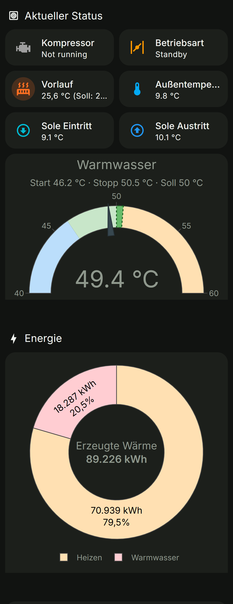
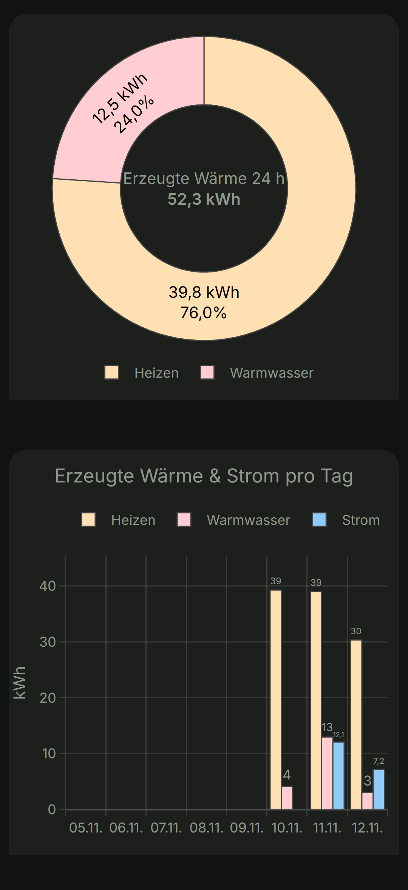
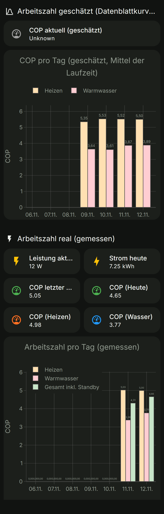
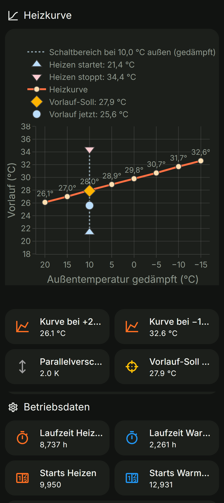
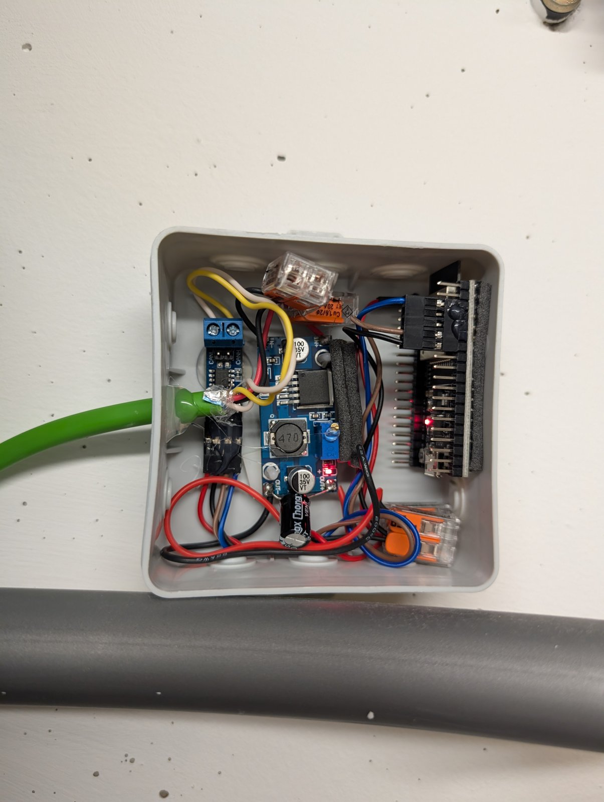

# Buderus Logatherm WPS → Home Assistant (ESPHome, ESP32, CAN)

Read a **Buderus Logatherm WPS** ground-source heat pump (developed and tested on a **WPS 8K-1**) directly from its internal CAN bus and show everything in **Home Assistant**:

- an **ESP32** with its built-in CAN controller and a **SN65HVD230** transceiver (about €10 of hardware), powered from the pump's own 12 V,
- **ESPHome** firmware that reads the parameters of the pump controller (the same requests a Buderus KM200 gateway or FHEM uses),
- temperatures, compressor state, operating mode, hot water thresholds, heating curve, energy and runtime counters, an estimated COP,
- a ready-made **Home Assistant dashboard**.

No cloud, no KM200, no changes to the pump. The firmware only **reads**.

> ## 🙏 Thank you, mike3436!
>
> **This whole project is based on the work of mike3436 from the [FHEM forum](https://forum.fhem.de/).**
> His FHEM module **26_KM273** and the [forum thread about it (topic 47508)](https://forum.fhem.de/index.php?topic=47508.0)
> decoded the KM273 protocol: the element-table transfer, the read/write CAN IDs, the value formats, the broadcast frames.
> Without his years of reverse engineering, and the many FHEM users who tested and documented their pumps in that thread,
> none of this would exist. This project "only" ports his findings to ESPHome and Home Assistant.
> **Big thanks!**

---

## What it looks like

| Home Assistant dashboard | | | | The adapter |
|---|---|---|---|---|
|  |  |  |  |  |

## How it works

```
 ┌────────────── Buderus WPS ──────────────┐            ┌──────── adapter ────────┐
 │  LCD ── BAS ── PSU ── PEL board          │  4 wires   │ SN65HVD230 ── ESP32     │   Wi-Fi   ┌────────────────┐
 │                       [CAN-H CAN-L ]─────┼────────────┼─▶ CAN       GPIO21/22   │ ────────▶ │ Home Assistant │
 │                       [ +12 V  GND ]─────┼────────────┼─▶ (fuse) → buck 3.3 V   │  ESPHome  │  + dashboard   │
 └──────────────────────────────────────────┘            └─────────────────────────┘    API    └────────────────┘
```

1. The pump's boards talk to each other over **CAN at 125 kbit/s** (29-bit IDs). The PEL board has a CAN connector for accessories (room controller, multi-module). The adapter is connected there.
2. Every parameter of the controller has an **index**. The ESP32 sends a read request (`0x04003FE0 | idx << 14`, remote frame) and the pump answers on `0x0C003FE0 | idx << 14`.
3. The parameter list differs between software versions, so you **dump your pump's own element table** once (≈ 76 kB, 30 s) and look up all indices there.
4. A small CSV defines which parameters are read and how often. A generator turns it into the ESPHome firmware.

## Documentation

| Step | Document | Content |
|---|---|---|
| 1 | [Hardware & wiring](docs/1-hardware.md) | Parts list, wiring diagram, power supply, building the adapter |
| 2 | [Connecting to the heat pump](docs/2-pump-connection.md) | PEL board, CAN connector, **Term switch**, measuring, first power-on |
| 3 | [Firmware](docs/3-firmware.md) | ESPHome setup, the three firmwares, element table dump, choosing parameters, generator |
| 4 | [Home Assistant](docs/4-home-assistant.md) | Entities, dashboard, examples, helper tools |
| 5 | [Protocol reference](docs/5-protocol.md) | KM273 CAN IDs, read requests, table format, broadcast frames |
| 6 | [Pump behaviour](docs/6-pump-behaviour.md) | What we learned from the data: hot water logic, heating thresholds, display offsets |

Quick start for the impatient (after the hardware is built and connected, see steps 1 and 2):

```bash
pip install esphome
cd esphome
cp secrets.example.yaml secrets.yaml      # fill in Wi-Fi, passwords, API key
esphome run buderus-wps.yaml              # 1. listen-only: check that frames arrive
esphome run buderus-wps-dump.yaml         # 2. dump your pump's element table (see docs/3-firmware.md)
python ../tools/km273_gen_monitor.py      # 3. generate the monitor firmware from tools/monitor_params.csv
esphome run buderus-wps-monitor.yaml      # 4. the firmware you keep running
```

## Repository layout

```
esphome/
  buderus-wps.yaml           listen-only sniffer (never transmits) – first test
  buderus-wps-dump.yaml      service firmware: dumps the element table
  buderus-wps-monitor.yaml   GENERATED – the firmware for normal operation
  km273_poller.h             cyclic parameter reader
  km273_dump.h               bus sniffer + element table dumper
  km273_cop.h                COP estimate from the datasheet
  secrets.example.yaml       template for secrets.yaml
tools/
  monitor_params.csv         which parameters are read, label, unit, scale, interval
  km273_gen_monitor.py       generates esphome/buderus-wps-monitor.yaml from the CSV
  km273_parse.py             decodes an element table dump into a CSV
  esphome_press.py           presses an ESPHome button and records the log (used for the dump)
  ha_dashboard.py            uploads a dashboard view to Home Assistant
  ha_entities.py             lists/removes Home Assistant entities
homeassistant/
  wps-dashboard-view.yaml    the "Wärmepumpe" dashboard view
  keller-heatpump-card.yaml  example: compact status card for another view
km273_dictionary.csv         element table of a WPS 8K-1 (1792 parameters) + labels and notes
data/                        raw element table dump of that pump (reference)
docs/                        this documentation
```

## Status and safety

- Tested on a **Logatherm WPS 8K-1** (controller HMC10-1). Other WPS-1 / WPS K-1 models and IVT Greenline pumps with the same controller generation very likely work too. Check the FHEM thread for your model.
- **Read-only.** The firmware never writes parameters. Writing is technically possible (FHEM does it), but a wrong index changes the wrong setting, and the FHEM thread reports alarms after careless writes.
- The pump contains **230/400 V**. Opening it and connecting to its boards is at your own risk and may affect warranty. If in doubt, let an electrician do it. See [docs/2-pump-connection.md](docs/2-pump-connection.md).
- This project is not affiliated with Bosch/Buderus. All trademarks belong to their owners.

## License

[MIT](LICENSE). No code of the FHEM module is included. This project re-implements the protocol knowledge documented by mike3436. The module 26_KM273 itself (GPL-2.0-or-later) is available from the FHEM SVN and the [forum thread](http://forum.fhem.de/index.php/topic,47508.0.html). The optional `--fhem` switch of `tools/km273_parse.py` reads your local copy of it to compare index numbering.
