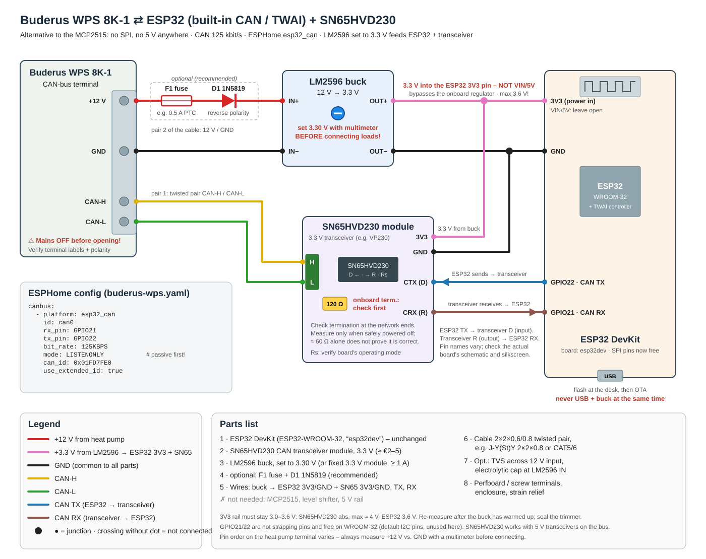
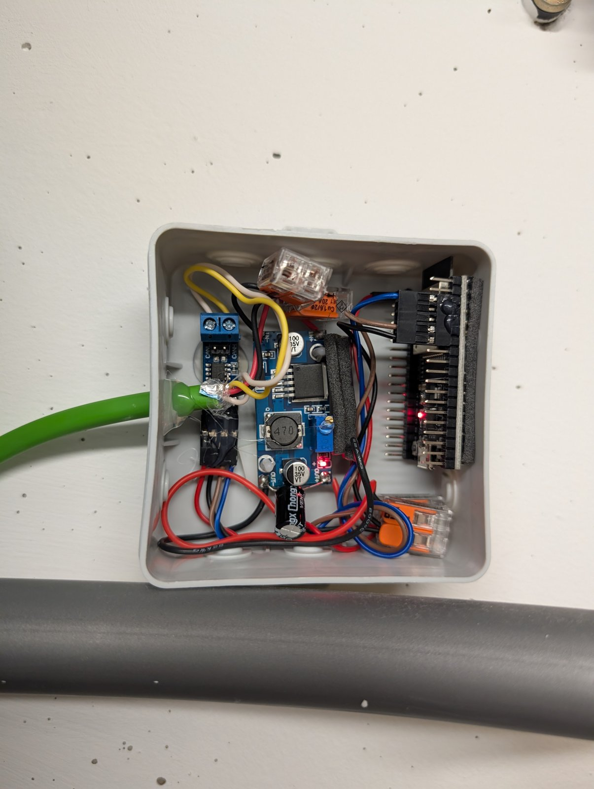

# 1 · Hardware & wiring

The adapter is an ESP32 with its built-in CAN controller (TWAI, ESPHome platform `esp32_can`) and a 3.3 V **SN65HVD230** CAN transceiver. Everything runs on **3.3 V**: a buck converter takes the pump's 12 V from the CAN connector and powers both the ESP32 (through its 3V3 pin) and the transceiver. You don't need an MCP2515, a 5 V rail or a level shifter.

### The finished adapter (reference build)

Left to right: the **SN65HVD230** module (screw terminal CANH/CANL at the top), the **LM2596** buck converter (set to 3.3 V, extra 100 µF capacitor on its output), the **ESP32** board. Lever connectors (Wago) distribute 3.3 V and GND. The green shielded cable comes from the pump (pair 1: CAN-H/CAN-L, pair 2: 12 V/GND). Everything sits in a small junction box on the wall next to the pump, outside the metal housing, where Wi-Fi reception is good.

## Parts list

| # | Part | Notes |
|---|------|-------|
| 1 | ESP32 DevKit (ESP32-WROOM-32) | Matches `board: esp32dev` in the firmware. Other ESP32 boards with TWAI work after adjusting `board` and pins. |
| 2 | SN65HVD230 CAN transceiver module (often sold as "VP230") | A 3.3 V part. Most modules have a **120 Ω termination resistor** on board, which this setup **uses** (see [step 2](2-pump-connection.md#the-term-switch-termination)). |
| 3 | Buck converter 12 V → 3.3 V | e.g. LM2596 module set to **3.30 V**. A fixed 3.3 V module (≥ 1 A) is safer because it has no trimmer that can drift. |
| 4 | Optional: F1 fuse + holder | e.g. 0.5 A slow-blow or PTC. Recommended: it protects the pump's 12 V supply against a short in your adapter. |
| 5 | Optional: D1 1N5819 Schottky diode | Reverse-polarity protection (≈ 0.3 V drop). Can be left out if you are sure about the polarity. |
| 6 | Cable with **2 twisted pairs**, shielded | Buderus recommends **LIYCY (TP) 2×2×0.5**. Pair 1: CAN-H/CAN-L, pair 2: +12 V/GND. Max. 30 m. |
| 7 | Optional: TVS diode SMBJ15A, 100 µF/25 V capacitor | Across the 12 V input (after D1 if fitted) |
| 8 | Perfboard, screw terminals, enclosure, cable gland | Mount the adapter **outside** the pump (Wi-Fi does not get through the metal housing) |

Cost: about €10–15 without cable and enclosure.

## Connections

| From | To | Note |
|------|----|------|
| Pump **+12 V** (CAN connector) | F1 → D1 (anode → cathode/stripe) → buck **IN+** | pair 2 |
| Pump **GND** (CAN connector) | buck **IN−** | pair 2 |
| Buck **OUT+ (3.3 V)** | ESP32 **3V3** pin **and** SN65HVD230 **3V3/VCC** | |
| Buck **OUT−** | ESP32 **GND** and SN65HVD230 **GND** | |
| ESP32 **VIN/5V** | **leave unconnected** | |
| ESP32 **GPIO22** (CAN TX) | SN65HVD230 **TXD / D / CTX** | |
| SN65HVD230 **RXD / R / CRX** | ESP32 **GPIO21** (CAN RX) | |
| Pump **CAN-H** | SN65HVD230 **CANH** | pair 1 (twisted) |
| Pump **CAN-L** | SN65HVD230 **CANL** | pair 1 (twisted) |
| Cable shield | GND/housing **at the pump end only** | |

The pins match all firmware files (`rx_pin: GPIO21`, `tx_pin: GPIO22`). GPIO21/22 are not strapping pins. Do **not** use the pins labelled TX/RX on the DevKit (GPIO1/GPIO3), because they belong to the USB serial console.

> **⚠ Never connect +12 V to CAN-H or CAN-L.** The Buderus manual warns that 12 V on the CAN lines destroys the processors of the pump's boards. Check every wire twice before connecting it to the pump.

## Building it, step by step

1. **Set the buck converter first.** Many LM2596 modules ship with an output close to the input voltage, and 12 V on the 3V3 pin destroys the ESP32 and the transceiver immediately.
   1. Connect 12 V (bench supply) with **nothing** on the output.
   2. Turn the trimmer until the output reads **3.30 V** (3.2–3.4 V is fine). It often needs many turns, usually counter-clockwise to lower the voltage.
   3. Measure again after a few minutes when the module is warm, then fix the trimmer with a drop of nail polish.
2. **Flash the ESP32 over USB at your desk** (see [step 3](3-firmware.md)), with the buck converter **not** connected.
3. Build the circuit. Before anything is plugged in, check with a multimeter:
   - no short between 3.3 V and GND, and none between 12 V and GND,
   - nothing connected to VIN/5V,
   - the 120 Ω resistor of the SN65HVD230 module: about 120 Ω between CANH and CANL on the module alone.
4. Power the adapter from a 12 V bench supply once: the ESP32 must boot and join your Wi-Fi.

## Power notes

- **Never power by USB and buck at the same time.** The DevKit's regulator would drive against the buck converter. Flash over USB with the buck disconnected, or update over the air (OTA).
- If you need USB on site, disconnect the 3.3 V wire first and use a laptop running on battery, to avoid ground loops through the pump.
- The ESP32 draws Wi-Fi peaks of up to ≈ 0.5 A at 3.3 V, which is well under 0.2 A at 12 V. The pump's 12 V rail also supplies accessories like the HRC 2 room controller, so a small adapter like this is within what that connector is meant for. The fuse and the diode are optional, but the fuse is cheap insurance for the pump's 12 V rail.
- Feeding the 3V3 pin bypasses the DevKit's own regulator. The ESP32 tolerates 3.0–3.6 V and the SN65HVD230 has an absolute maximum of about 4 V, so there is no further protection.

## Cable

- Use a twisted pair for CAN-H/CAN-L (the second pair carries 12 V/GND).
- Keep at least **100 mm** distance from 230/400 V cables (Buderus requirement). Running it next to sensor cables is allowed.
- Shield: connect it to GND/housing **at one end only** (the pump end).
- At 125 kbit/s a few metres are no problem. The maximum is 30 m.

Next: [2 · Connecting to the heat pump](2-pump-connection.md)
