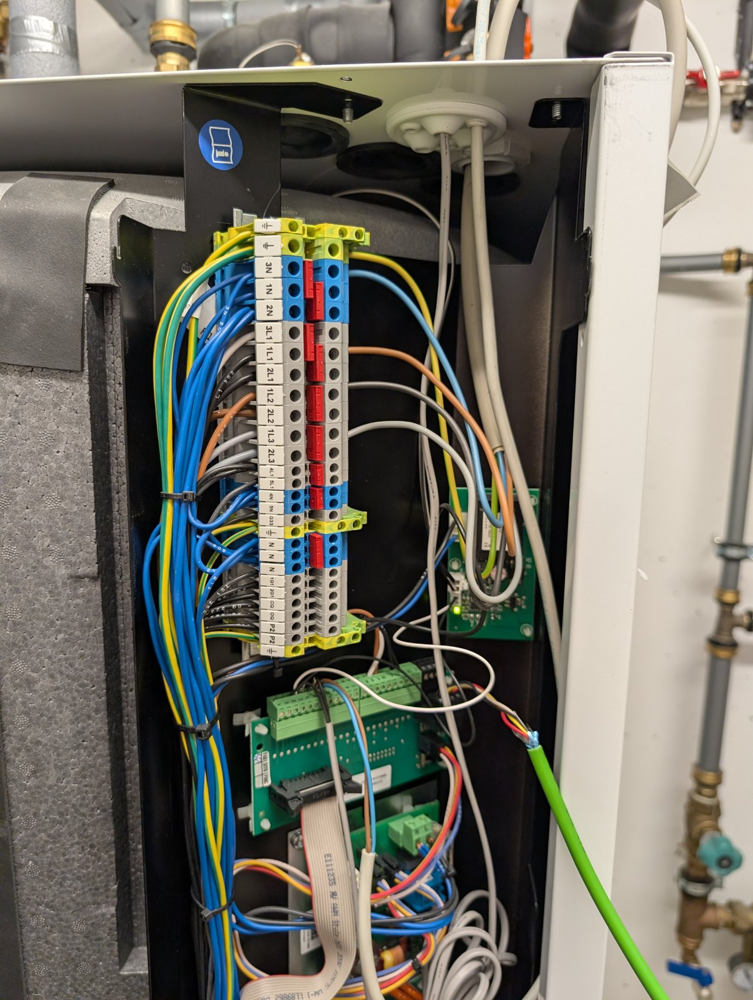
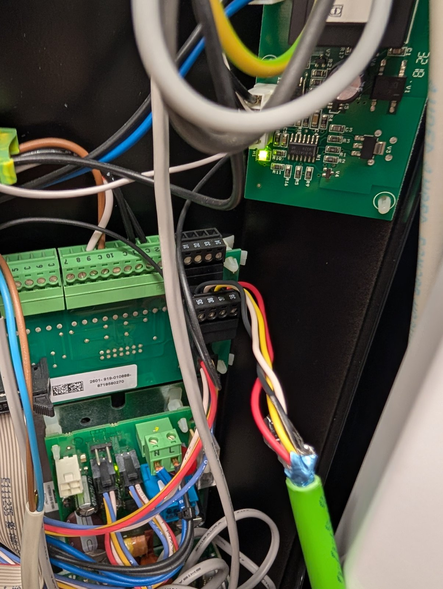

# 2 · Connecting to the heat pump

> **⚠ Danger: 230/400 V.** Switch the heat pump off **at the breaker** (all circuits: compressor and electric heater) before you open the housing, and check that it is dead. Keep your wiring away from the mains terminals. If you are not trained for this, let an electrician make the connection. Work on the pump may affect warranty. You do it at your own risk.

References in this chapter point to the Buderus installation manual *Logatherm WPS 6K-1…10K-1, 6-1…17-1* (6 720 822 202), chapter 10 "Elektrischer Anschluss". Download it from buderus.de and keep it at hand.

## The pump's CAN bus

All boards inside the pump talk over one CAN bus (125 kbit/s). The bus is a chain with a **termination at each end**, set with a small switch labelled **Term** on the boards at the ends (manual, figure 34 "CAN-BUS-Übersicht"):

```
  PEL  ───── PSU ───── BAS ───── LCD
 [Term ON]                     [Term ON]
   ▲                               ▲
 one end of the bus          other end (display/controller)
```

| Board | Function |
|---|---|
| **PEL** | Connection board: external inputs (EVU signal etc.) and the **CAN connector for accessories** (room controller HRC 2, multi-module, passive cooling station) |
| PSU | Power supply board (12 V and 15 V for the bus and the boards) |
| BAS | Main controller board (settings P/A rotary switches) |
| LCD | Display and control unit (HMC10-1) |

Each CAN connection has **four wires**: +12 V, GND, CAN-H, CAN-L. The boards are marked for the 12 V and CAN-BUS contacts.

## Where to connect the adapter

Connect the adapter to the **CAN-BUS connector on the PEL board**, the same place where Buderus accessories like the HRC 2 room controller are connected. This gives you CAN-H, CAN-L and the 12 V supply for the adapter in one place.

1. Switch the pump off at the breaker and wait a few minutes.
2. Open the front cover and the electrical box. The PEL board is in the electrical box (manual, figure 33 "Übersicht Leiterplatte", variant a) for WPS K-1).
3. Find the 4-pole CAN connector and the **Term** switch next to it. **Read the markings on your board** for +12 V, GND, CAN-H, CAN-L and write them down. Don't rely on positions in photos from other pumps.
4. Run your cable through a free cable gland, away from mains cables (≥ 100 mm), and connect it.

On the reference WPS 8K-1 it looks like this:

| Electrical box with the adapter cable | Detail: connection on the board |
|---|---|
|  |  |
| Mains terminal strip on the left (**230/400 V, stay away**). The green shielded cable enters at the right and runs down to the boards. | The four wires (red, yellow, white, black) go into the black **4-pole terminal 35–38**. The shield is folded back and taped at this end. Check the 12 V/GND/CAN-H/CAN-L assignment on **your** board's markings or the wiring diagram before connecting. |

Connections:

| PEL CAN connector | Adapter |
|---|---|
| CAN-H (CANH) | SN65HVD230 CANH (twisted pair 1) |
| CAN-L (CANL) | SN65HVD230 CANL (twisted pair 1) |
| +12 V | (optional fuse → diode →) buck IN+ (pair 2) |
| GND | buck IN− (pair 2), cable shield |

## The Term switch (termination)

A CAN bus needs **exactly two** 120 Ω terminations, one at each physical end. The manual says it plainly: *"Der Schalter Term markiert Anfang und Ende der CAN-BUS-Verbindung. Achten Sie darauf, dass die richtigen Karten terminiert sind und alle übrigen nicht terminiert sind."* And for accessories: *"Wird zusätzlich ein Multimodul, eine Passive Kühlstation oder ein Raumregler HRC 2 installiert, muss das letzte Bauteil in der CAN-BUS-Kette terminiert werden."*

Our adapter is connected like such an accessory, at the end of the chain behind the PEL board. So:

| | Before | With the adapter |
|---|---|---|
| **PEL Term switch** | ON | **OFF** |
| SN65HVD230 120 Ω resistor | (not connected) | **fitted**: the adapter is the new bus end |
| LCD Term | ON | ON (don't touch) |

```
  ESP32+SN65 ───── PEL ───── PSU ───── BAS ───── LCD
  [120 Ω]       [Term OFF]                     [Term ON]
```

This is the setup used on the reference WPS 8K-1. It ran with zero bus errors.

> **If you remove the adapter later, switch the PEL Term switch back ON!** Otherwise the pump's bus has only one termination left and can show communication errors.

### Check with a multimeter (pump powered off, at the breaker)

Measure **resistance between CAN-H and CAN-L**:

| Situation | Expected |
|---|---|
| PEL Term ON, adapter not connected (original state) | ≈ 60 Ω (two × 120 Ω in parallel) |
| PEL Term OFF, adapter not connected | ≈ 120 Ω (only the LCD) |
| PEL Term OFF, adapter connected | ≈ 60 Ω ✔ |
| PEL Term ON **and** adapter with 120 Ω | ≈ 40 Ω ✘ (three terminations: switch PEL Term OFF) |

### Check voltages (pump powered on, adapter not yet connected)

| Measure | Expected |
|---|---|
| +12 V against GND | ≈ 12 V |
| CAN-H against GND | ≈ 2.5–3.5 V |
| CAN-L against GND | ≈ 1.5–2.5 V |

Then switch the pump off again before connecting the adapter.

## First power-on

1. The ESP32 is flashed with the **listen-only** firmware `buderus-wps.yaml` (see [step 3](3-firmware.md#step-1-listen-only-test)). It never transmits, not even acknowledgements, so it can't disturb the bus.
2. Connect the adapter, close the electrical box, switch the pump on.
3. The ESP32 joins Wi-Fi. In the log (`esphome logs buderus-wps.yaml`) you should see frames, and the **CAN frame rate** sensor shows ≈ **2–3 frames/s** (the pump's boards broadcast their sensor values).
4. Check the pump's display: **no new alarms**.

Only when this works for a while, flash the monitor firmware, which actively sends read requests.

## Troubleshooting

| Symptom | Likely cause |
|---|---|
| No frames at all, frame rate 0 | CAN-H/CAN-L swapped, RX/TX pins swapped (GPIO21 = RX from the transceiver, GPIO22 = TX to it), wrong bit rate, adapter not powered |
| Frames arrive in listen-only mode, but after switching to NORMAL the bus goes **bus-off** / TX errors | Defective transceiver module (happened on the reference build: the first SN65HVD230 module was faulty and a replacement worked at once), or wrong termination |
| Pump shows communication alarms after connecting | Termination wrong (check the table above), or the Term switch forgotten after removing the adapter. Disconnect the adapter and restore Term ON. |
| ESP32 resets / Wi-Fi drops | Buck voltage too low, or bad Wi-Fi reception: mount the adapter outside the metal housing |

Next: [3 · Firmware](3-firmware.md)
