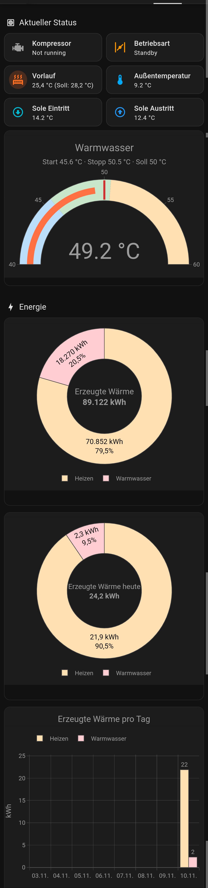
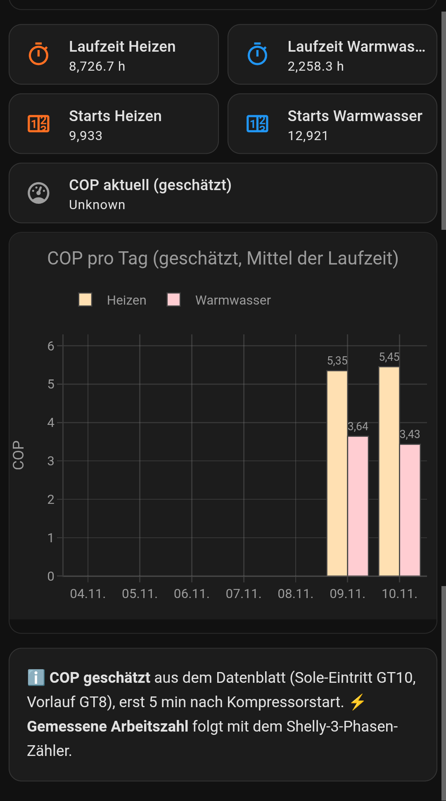
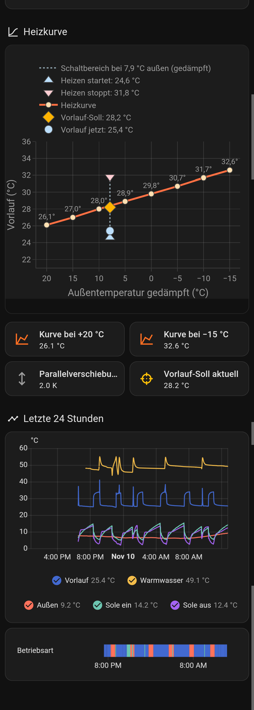

# 4 · Home Assistant

## Adding the device

1. Once the monitor firmware runs, Home Assistant discovers it automatically: **Settings → Devices & services → ESPHome → "Buderus WPS" → Configure**.
2. Enter the `api_encryption_key` from `esphome/secrets.yaml`.
3. Optionally assign an **area**. Note: this changes nothing about the entity IDs that were already created, but entities created *after* assigning the area may get the area as prefix. The reference installation has the area "Haus", so its entities are called `sensor.haus_buderus_wps_…`. Without an area they are `sensor.buderus_wps_…`.

Find out which prefix you have:

```bash
python tools/ha_entities.py list buderus_wps
```

```
sensor.haus_buderus_wps_hot_water_gt3        45.2   esphome   Hot water GT3
sensor.haus_buderus_wps_operating_mode       Heizen esphome   Operating mode
...
```

Or in the UI: **Settings → Entities**, search "buderus".

## Entities (examples)

The entity ID is derived from the `label` in `tools/monitor_params.csv`:

| Label | Entity ID (prefix `sensor.<area>_buderus_wps_`) | Example |
|---|---|---|
| Operating mode | `…operating_mode` | `Heizen` / `Warmwasser` / `Standby` |
| Compressor running | `binary_sensor.…compressor_running` | `on` |
| Heating flow GT1 | `…heating_flow_gt1` | 31.4 °C |
| Flow setpoint | `…flow_setpoint` | 30.9 °C |
| Outdoor GT2 | `…outdoor_gt2` | 6.1 °C |
| Hot water (display) | `…hot_water_display` | 49.2 °C (as on the pump display) |
| Hot water GT3 | `…hot_water_gt3` | 45.2 °C (raw tank sensor) |
| Brine in GT10 / out GT11 | `…brine_in_gt10`, `…brine_out_gt11` | 8.6 / 5.9 °C |
| Heat produced heating / hot water | `…heat_produced_heating`, `…heat_produced_hot_water` | 70851 kWh (lifetime counters, usable in the energy dashboard) |
| Compressor starts heating / hot water | `…compressor_starts_heating`, … | 9933 |
| Estimated COP | `…estimated_cop` | 5.6 |

## The dashboard

[`homeassistant/wps-dashboard-view.yaml`](../homeassistant/wps-dashboard-view.yaml) is a complete dashboard **view** (type *sections*, German labels):

| Section | Content |
|---|---|
| **Aktueller Status** | Tiles: compressor, operating mode, flow with setpoint, outdoor temperature. Hot water **gauge** with start/stop range and setpoint. |
| **Energie** | Donut of the produced heat (heating vs. hot water, lifetime), a second donut for **today**, bars **per day**, estimated COP per day |
| **Heizkurve** | The heating curve as configured in the pump, with today's operating point |
| **Letzte 24 Stunden** | History graphs of temperatures and states |

Screenshots of the reference installation (phone, dark theme):

| Status, hot water, energy | Counters and COP | Heating curve, last 24 h |
|---|---|---|
|  |  |  |
| Compressor, mode, flow with setpoint, brine. Hot water gauge with start/stop range. Heat produced: lifetime, today, per day. | Runtimes and starts for heating and hot water. Estimated COP per day. | The heating curve with today's operating point and the current start/stop band. Temperatures and operating mode over 24 h. |

### Requirements

- **HACS** with the frontend card **[plotly-graph-card](https://github.com/dbuezas/lovelace-plotly-graph-card)** (v3 or later). All other cards are built in.
- The pump's energy counters must have long-term statistics. That is automatic, because the firmware marks them `total_increasing`. The "per day" bars fill up from the day the sensors were created.

### Installing the view

1. **Adapt the entity prefix.** The file uses `sensor.haus_buderus_wps_` (area "Haus"). If your entities are named differently, replace it everywhere:

   ```bash
   # Linux/macOS: entities without area
   sed -i 's/haus_buderus_wps_/buderus_wps_/g' homeassistant/wps-dashboard-view.yaml
   ```
   ```powershell
   # Windows PowerShell
   (Get-Content homeassistant\wps-dashboard-view.yaml -Raw) -replace 'haus_buderus_wps_','buderus_wps_' | Set-Content -Encoding utf8 homeassistant\wps-dashboard-view.yaml
   ```

2. **Either via the UI:** open a dashboard → ✏ Edit → **+ Add view** → open the new view's settings → ⋮ **Edit in YAML** → replace everything with the file's content → Save.

3. **Or with the script** (replaces the view with the same `path: waermepumpe` in an existing dashboard and saves a backup of the whole dashboard to `homeassistant/backups/` first):

   ```bash
   # once: create a long-lived access token (HA profile → Security) and store it
   echo "<token>" > ~/.ha_token                      # Windows: %USERPROFILE%\.ha_token
   export HA_WS_URL=ws://homeassistant.local:8123/api/websocket   # default; set it if your HA has another address

   python tools/ha_dashboard.py views lovelace        # list the views of the default dashboard
   python tools/ha_dashboard.py push lovelace homeassistant/wps-dashboard-view.yaml
   ```

   `lovelace` is the default dashboard; for another dashboard use its URL path. The view must already exist once (step 2 with only `path: waermepumpe`), then `push` keeps it up to date.

### A compact card for another page

[`homeassistant/keller-heatpump-card.yaml`](../homeassistant/keller-heatpump-card.yaml) is an example of a small status block (operating mode, flow, hot water, outdoor temperature) that links to the full view. It needs the HACS cards **button-card** and **card-mod**. Add it with *Add card → Manual*, and adapt the entity prefix as above.

## Examples

### Notification when hot water is low

```yaml
automation:
  - alias: "Warmwasser niedrig"
    triggers:
      - trigger: numeric_state
        entity_id: sensor.buderus_wps_hot_water_display
        below: 44
        for: "00:15:00"
    actions:
      - action: notify.notify
        data:
          message: "Warmwasser nur noch {{ states('sensor.buderus_wps_hot_water_display') }} °C"
```

### Count compressor starts per day

```yaml
utility_meter:
  wps_starts_heating_daily:
    source: sensor.buderus_wps_compressor_starts_heating
    cycle: daily
  wps_starts_hot_water_daily:
    source: sensor.buderus_wps_compressor_starts_hot_water
    cycle: daily
```

### Average compressor run time today (template sensor)

```yaml
template:
  - sensor:
      - name: "WPS mittlere Laufzeit Heizen heute"
        unit_of_measurement: "min"
        state: >
          
          
          {{ (hours * 60 / starts) | round(1) if starts > 0 else 0 }}
```

(`wps_runtime_heating_daily` is a second `utility_meter` on `sensor.buderus_wps_compressor_runtime_heating`.)

### Energy dashboard

Add `sensor.buderus_wps_heat_produced_heating` and `…_hot_water` under **Settings → Dashboards → Energy** as individual devices to see the heat produced per day/week/month. Together with an electricity meter in the pump's supply (e.g. a Shelly Pro 3EM) you get the real COP = heat ÷ electricity.

## Helper scripts

| Script | Purpose |
|---|---|
| `tools/ha_entities.py list <text> [--unavailable]` | List entities whose ID contains `<text>`, with state and platform. `--unavailable` shows only orphaned ones, e.g. after renaming labels. |
| `tools/ha_entities.py remove <entity_id> …` | Remove orphaned entities from the registry |
| `tools/ha_dashboard.py views/push …` | See above |

All of them read the token from `~/.ha_token` (never printed) and the address from `HA_WS_URL`.

Next: [5 · Protocol reference](5-protocol.md)
