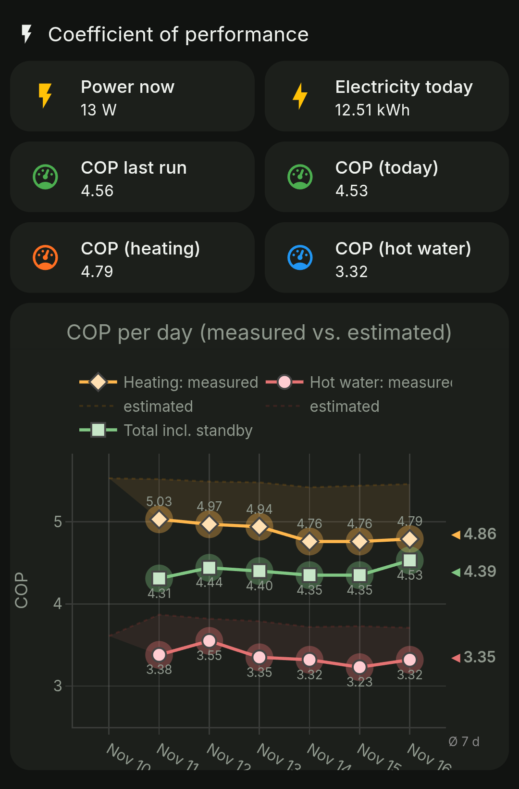

# 7 · Electricity meter and measured COP (Shelly Pro 3EM)

The WPS reports the **heat** it produces (`STATS_ENERGY_OUTPUT_*`), but it has **no electricity measurement**: the current, voltage and frequency parameters read 0. Without a meter you only get the COP **estimated** from the datasheet curves (see [6 · Pump behaviour](6-pump-behaviour.md#cop-estimate)).

With an electricity meter in the pump's supply you get the **real COP** = heat ÷ electricity, split by heating, hot water and standby:

| Entity | Meaning |
|---|---|
| `sensor.wps_cop_last_run` | COP of the last compressor run (start → 60 s after stop). Attributes: `mode` (heating / hot_water / mixed), `minutes`, `heat_kwh`, `electricity_kwh` |
| `sensor.wps_cop_heating_today` / `_hot_water_today` | Heat ÷ electricity today while the compressor runs in that mode |
| `sensor.wps_cop_today` | All heat ÷ all electricity today, **standby included** (what you actually pay for) |
| `sensor.wps_electricity_heating` / `_hot_water` / `_standby` | Lifetime kWh per mode, for the Energy dashboard and the daily charts |
| `sensor.wps_electricity_today` | Electricity today |

On the dashboard this fills the **Coefficient of performance** section and the electricity bars in **Heat & electricity per day**:



The COP-per-day chart shows the measured COP as strong lines, the datasheet estimate as faint dotted lines (the gap between them is tinted), and the **7-day average** per mode as triangles on the right y-axis (heat ÷ electricity over the last 7 days, i.e. energy-weighted).

## 1 · Hardware

The reference installation uses a **Shelly Pro 3EM** (DIN rail, three current transformers, LAN or Wi-Fi). Any meter that gives Home Assistant a **power** sensor (W) and a lifetime **energy** sensor (kWh, `total_increasing`) works too, e.g. a Shelly 3EM (Gen 1), a Shelly Pro EM for a single-phase pump, or a Modbus meter. Only the entity IDs change.

> ⚠️ **This work is done in the distribution board at 230/400 V. Let an electrician install the meter.**

1. **Where:** in the distribution board, on the circuit that feeds the heat pump (WPS 8K-1: 3 × 400 V).
2. **Current transformers:** one clamp per phase (L1, L2, L3) around the conductors **going to the pump**, with the arrow on the clamp pointing towards the pump (direction of energy flow). Clamp phase *n* to CT input *n*.
3. **Voltage taps:** L1/L2/L3/N of the Shelly to the **same phases** as the matching clamps. A clamp on L2 with the voltage of L1 gives wrong (often negative or much too small) power.
4. **Power for the Shelly:** from its own small breaker, not behind the pump's breaker, so it keeps counting when the pump circuit is off.
5. **Everything the pump draws must pass through the clamps.** If your pump has a separate supply (e.g. for the electric heater or the control circuit), put it through the clamps as well, or that energy is missing from the COP. The reference installation draws ~13 W in standby through the meter.

Check after the installation (Shelly web UI or app, compressor running):

- all three phases show **positive** power; a negative phase means the clamp is reversed or on the wrong phase,
- the total roughly matches the pump's datasheet power at the current operating point (WPS 8K-1: about 1.5–2 kW while heating, more for hot water).

**Device profile:** a Shelly Pro 3EM must be in the **triphase** profile (the default). Only that profile has the *total* active power/energy entities the package uses.

## 2 · Add the Shelly to Home Assistant

1. **Settings → Devices & services**: the Shelly is usually discovered automatically, otherwise **Add integration → Shelly** and enter its IP address.
2. Optionally give it a name and an area. The entity IDs follow from both. The reference installation has the device name "WPS 8K1 3EM Pro" in area "Haus", so the two entities used are:

   | Used for | Entity in the reference installation |
   |---|---|
   | total active **power** (W) | `sensor.haus_wps_8k1_3em_pro_power` |
   | total active **energy** (kWh, lifetime) | `sensor.haus_wps_8k1_3em_pro_energy` |

   Find yours with `python tools/ha_entities.py list 3em` or under **Settings → Entities**.
3. **Keep the database small.** The Shelly reports every few seconds; its per-phase and apparent-power sensors alone wrote ~33,000 rows per day here. Only the total power and energy are used. Disable the rest under **Settings → Entities** (select → *Disable*); disabled entities are neither processed nor stored. (Enable the per-phase sensors temporarily when you want to check the wiring or look at the electric heater.)

## 3 · Install the package

[`homeassistant/wps-energy-package.yaml`](../homeassistant/wps-energy-package.yaml) contains everything: the energy split, the daily counters, the COP sensors and the automation. It is a Home Assistant [package](https://www.home-assistant.io/docs/configuration/packages/), i.e. one file that you drop into `/config/packages/`.

1. Enable packages once in `configuration.yaml` (if not already done):

   ```yaml
   homeassistant:
     packages: !include_dir_named packages
   ```

2. Copy the file to `/config/packages/wps_energy.yaml` (File editor / Studio Code Server add-on, Samba share, or `scp`).
3. **Adjust the entity IDs** with search & replace in that file:

   | Search | Replace with your … |
   |---|---|
   | `sensor.haus_wps_8k1_3em_pro_power` | meter's total power entity |
   | `sensor.haus_wps_8k1_3em_pro_energy` | meter's total energy entity |
   | `haus_buderus_wps_` | pump prefix, e.g. `buderus_wps_` if your device has no area (see [4 · Home Assistant](4-home-assistant.md#adding-the-device)) |

   From the pump the package needs `binary_sensor.…compressor_running`, `sensor.…diverter_valve`, `sensor.…heat_produced_heating` and `sensor.…heat_produced_hot_water`. All of them are in the default `tools/monitor_params.csv`; the heat counters are polled every 30 s so a single run can be measured.
4. **Recorder:** the package has a `recorder: exclude:` block for its helper counters and two ESP32 diagnostics. It merges with the `recorder:` section of `configuration.yaml` as long as that one has **no `exclude:` of its own**. If it has, move the entries there and delete the block from the package.
5. **Developer tools → YAML → Check configuration**, then **restart** Home Assistant. A reload is not enough: `utility_meter` is only set up at start.

After the restart you should see `select.wps_electricity` (the current tariff: heating / hot_water / standby) and the `sensor.wps_*` entities. The COP sensors stay **unavailable** until at least 0.2 kWh were used in that mode today; `wps_cop_last_run` gets its first value 60 s after the next compressor stop.

**Updating** the package later (e.g. from a new version of this repository): copy the file again, redo the search & replace, then **Developer tools → YAML → Template entities** reload is enough for changes to the template sensors; changes to `utility_meter` or `sensor:` need a restart.

## 4 · How it works

**Splitting the electricity.** An automation switches the tariff of one `utility_meter` (`select.wps_electricity`) whenever the compressor or the diverter valve changes (plus every 5 min as a safety net): compressor off → *standby*, valve towards the tank → *hot_water*, else *heating*. While the ESP32 is unavailable (reboot, OTA) the tariff is kept.

The source of that meter is **not** the Shelly's kWh counter but the integral of its power (`sensor.wps_electricity_fast`, Riemann sum). The kWh counter only updates once a minute, and a utility meter books each update to the tariff active *when it arrives*, so up to a minute of energy landed in the wrong mode at every switch, 2–4 % of a ~1 kWh run. The power updates every ~16 s, and its integral matched the Shelly counter within 0.2 %.

**COP today.** Daily `utility_meter`s for heat and electricity per mode, divided by each other. At midnight the daily meters reset ~30 ms apart; the COP sensors are only available when heat and electricity have the same `last_reset`, otherwise they would show 0.0 for a moment.

**COP of the last run.** A trigger-based template sensor stores the heat and energy counters when the compressor starts and compares them 60 s after it stops (the last heat counter step arrives within ~20 s after a stop). The electricity includes the pumps' run-on in those 60 s. A run is classified *heating* or *hot_water* when more than 80 % of its heat went there, otherwise *mixed*. If the compressor restarts within the 60 s, both runs count as one.

**Heat.** The heat comes from the pump's own counters (0.01 kWh resolution). The pump has no flow meter that we know of, so it is probably the pump's own calculation rather than a measurement; treat the absolute COP with some caution. Comparisons (day to day, heating vs. hot water, before/after a settings change) are reliable.

## 5 · Reading the numbers

- **Typical values** (WPS 8K-1, November, brine in ~8 °C): heating ~5, hot water ~3.5–3.8, overall incl. standby ~4.5.
- **Overall COP higher than both mode COPs?** That is not a bug. Each day mixes heating (high COP) and hot water (low COP) in different shares. The 7-day average of the total can sit above the 7-day average of each mode when the days with more hot water had less heat overall.
- **Measured vs. estimated.** The datasheet estimate only looks at brine and flow temperature. A persistent gap shows how your installation differs from the datasheet (circulation pumps, start-up losses, hydraulics).
- **Single runs scatter more than days.** Short hot water top-ups (5–6 min) carry the start-up and run-on losses on very little heat.

## Energy dashboard

Add the pump to **Settings → Dashboards → Energy**:

- *Electricity grid → individual devices*: `sensor.wps_electricity_heating`, `_hot_water`, `_standby` (or simply the Shelly energy entity),
- heat: `sensor.<prefix>_buderus_wps_heat_produced_heating` and `…_hot_water` as further individual devices.

Back to: [README](../README.md) · [4 · Home Assistant](4-home-assistant.md)
